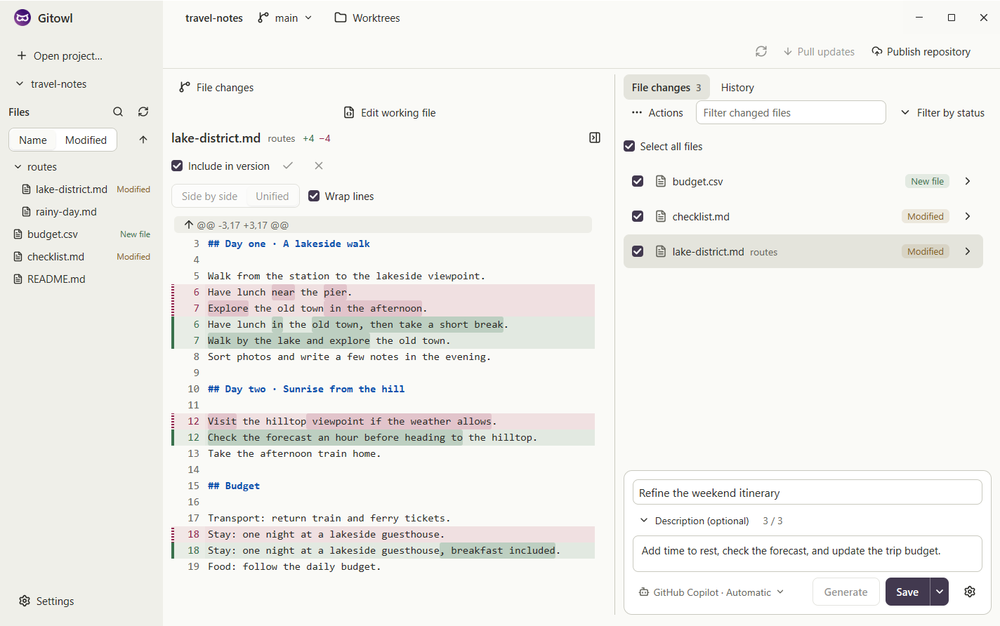
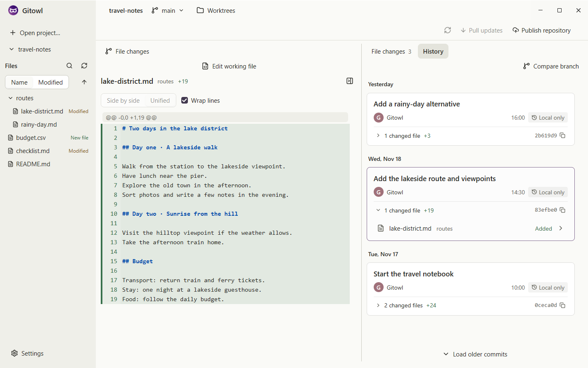
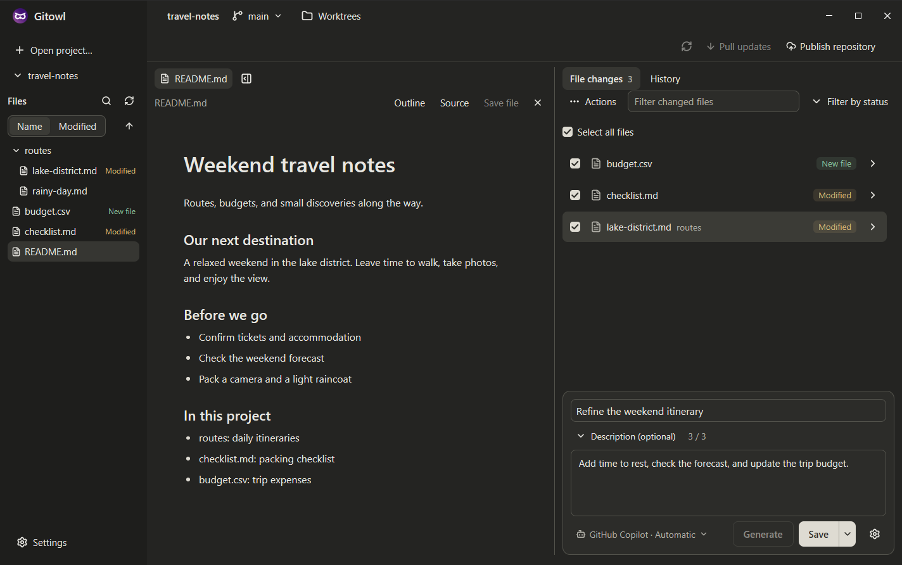
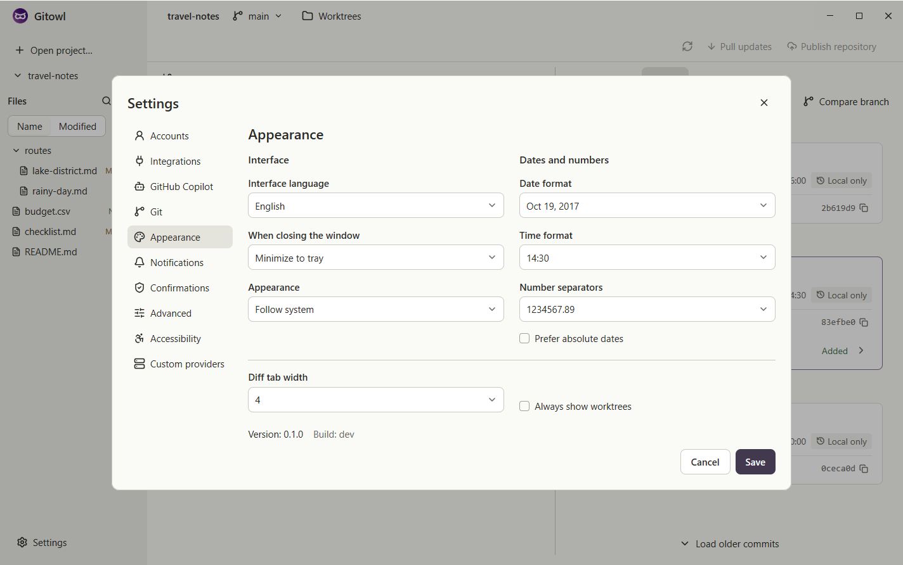

<!-- markdownlint-disable MD041 -->

# Gitowl

A simple desktop app to track file changes and save project versions

[简体中文](README.md) | English

## What Gitowl is

Gitowl is a local desktop app that helps you see what changed in your project folders and save versions on your computer. You do not need to type commands or learn technical terms. Click clear buttons to review changes, write a short note, and save a version at any time.

## Software preview

<table>
<tr>
<td> File changes and review</td>
<td> History timeline</td>
</tr>
<tr>
<td> Markdown editing (dark appearance)</td>
<td> Language and appearance settings</td>
</tr>
</table>

## Why use Gitowl

- **Use buttons instead of commands.** Open a project folder and click clear buttons. You do not need a command window.
- **Start without an account.** Click **Skip sign-in** on first launch to manage project folders on your computer.
- **See every text change clearly.** Click a changed file to view added and removed lines side by side or in one column.
- **Compare changed images visually.** View old and new images side by side, with a swipe slider, overlaid, or highlighted by difference.
- **Keep local saves separate from uploads.** Click **Save version** to keep a version on your computer. Nothing uploads until you click **Push changes** or choose **Save version and push**.
- **Draft version notes automatically.** Select changed files and click **Generate message**. Gitowl writes a draft summary and description for you to review, and never saves or uploads automatically. You can use GitHub Copilot or add your own AI service.
- **Review past versions on a timeline.** Open **History** to see saved versions grouped by date, with the author and changed files.
- **Protect against accidental loss.** Gitowl asks you to confirm before it discards changes or runs actions that cannot be undone. Discarded changes go to the Windows Recycle Bin when your system allows it.
- **Switch interface languages.** Use Gitowl in Simplified Chinese, Traditional Chinese, or English. On first launch, Gitowl matches your Windows display language. You can set the note generation language separately.
- **Choose your look and close behavior.** Pick **Light**, **Dark**, or **Follow system** in **Settings**. Choose whether closing the window exits the app or minimizes it to the system tray.

## Quick start

1. **Open a project.** Click **Open project…** on the left. Add an existing folder on your computer, create a new folder, or download one from your account.
2. **Review your changes.** Open **File changes** on the right and select the files to include. Click any file to check its changes in the center panel.
3. **Write a short note and save.** Enter a title in **Version summary**, or click **Generate message** to write a draft. Click **Save version**, or press `Ctrl+Enter`.
4. **Sync when ready.** Click **Pull updates** to download new changes from online. Click **Push changes** to upload your saved versions.

## Data and privacy

- **Your projects stay on your computer.** Opening folders, viewing changes, and saving local versions do not upload your files.
- **Sign-in uses your web browser.** When you sign in to GitHub, you enter your password in your browser. Gitowl never asks for your password.
- **Credentials use Windows secure storage.** Account logins and AI service keys are stored in the Windows credential manager, not in plain text files.
- **AI generation asks before sending changes.** Gitowl sends only the changes of the files you selected, and only after you confirm the target service.
- **Settings and logs stay local.** App settings, project lists, and log files are stored in your Windows user app data folder.
- **Usage reports are optional.** You can opt out of usage reporting in **Settings**.
- **Automatic updates are not enabled.** This test version does not download or install updates in the background.

## System requirements

Gitowl currently provides a test version for 64-bit Windows 10 and Windows 11. Some advanced features are still being added.

## Common questions

### Do I need a GitHub account to use Gitowl?

No. Click **Skip sign-in** during first-run setup to manage local project folders right away. You only need an account to sync online projects or use GitHub Copilot.

### Does Save version upload my files online?

No. **Save version** saves a version on your computer only. Your files upload only when you click **Push changes** or choose **Save version and push**.

### Does Generate message edit my files or save automatically?

No. **Generate message** only fills **Version summary** and **Description (optional)** with a draft. Review and edit the text, then click **Save version** yourself.

### How do I change the language or theme?

Open **Settings** and select **Appearance**. Switch between **Simplified Chinese**, **Traditional Chinese**, **English**, or **Follow system**, and choose **Light**, **Dark**, or **Follow system**.

### What happens if I discard a change by mistake?

Gitowl asks you to confirm before it discards changes. When your system allows it, discarded changes move to the Windows Recycle Bin so you can restore them.

## License

Gitowl is based on [GitHub Desktop](https://github.com/desktop/desktop). The desktop interface uses [MyGo](https://github.com/egoist/mygo).

Gitowl uses the [MIT License](LICENSE). Third-party components and assets keep their own licenses. See [third-party sources and licenses](third_party/README.md) for details.
