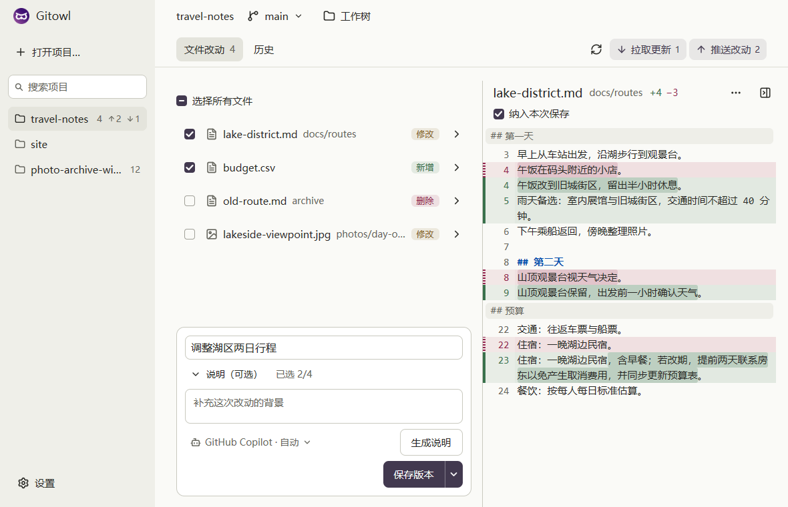
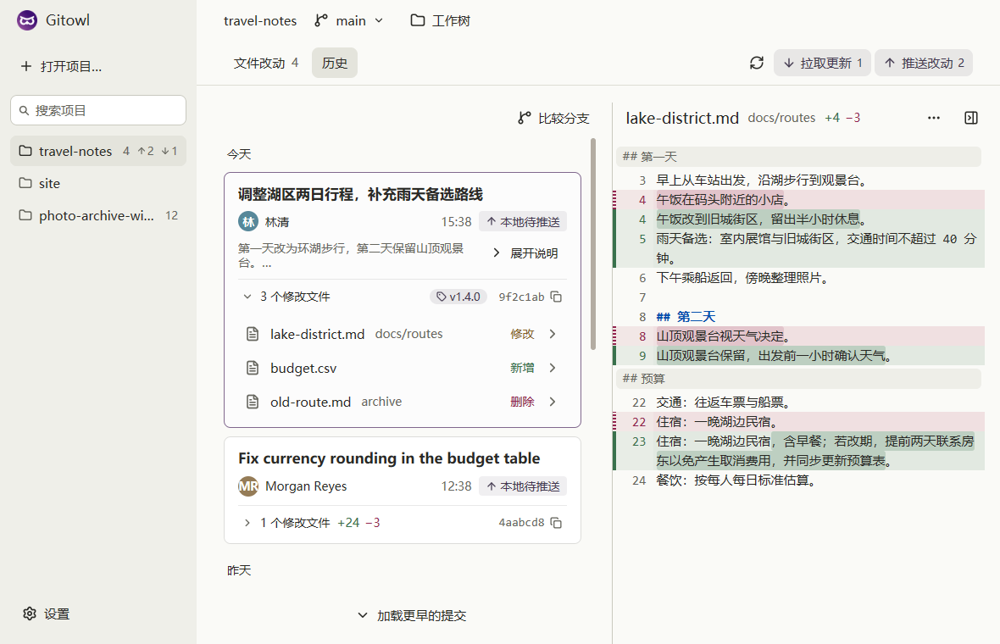
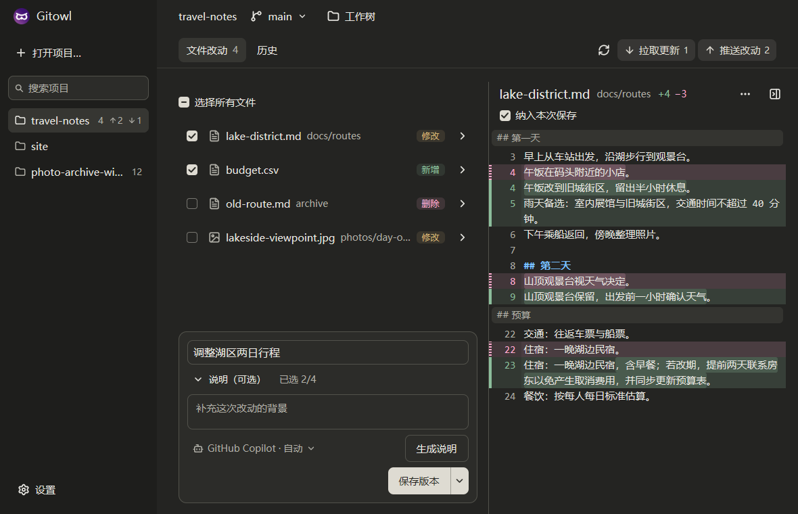
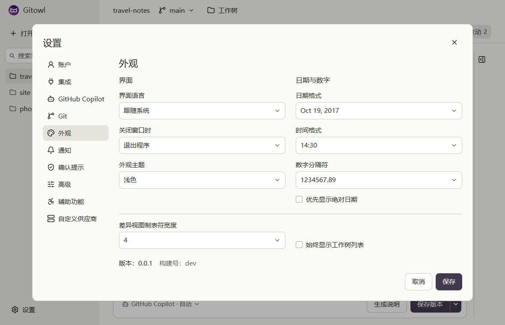

<!-- markdownlint-disable MD041 -->

# Gitowl

简单好用的项目版本管理工具，帮你看清每一次修改、安心保存每一个版本

[English](README.en.md) | 简体中文

## Gitowl 是什么

Gitowl 是一款运行在电脑本地的项目版本管理软件。你不需要背任何命令，也不用记专业术语。只要点几下鼠标，就能看清文件改了哪里、写上简短说明并保存历史版本，方便随时回看。

## 软件预览

<table>
<tr>
<td> 文件改动与对比</td>
<td> 历史时间线</td>
</tr>
<tr>
<td> 深色主题</td>
<td> 语言与外观设置</td>
</tr>
</table>

## 为什么使用 Gitowl

- **不用背命令，点按钮就能用**：打开项目文件夹即可开始，全程图形界面操作，不需要打开黑框输入命令。
- **不登录也能直接用**：首次打开时点击 **跳过登录**，就能先管理自己电脑上的本地项目文件夹。
- **文字修改一目了然**：点开任意修改过的文件，即可在右侧看到新增和删除的内容，支持并排对比和单栏对比。
- **图片修改也能直观对比**：支持图片并排、拖动滑块、透明叠加和高亮不同之处四种对比方式。
- **本地保存与上传分开，不怕误传**：点击 **保存版本** 只会在你自己的电脑上留下记录，不会自动发到网上；只有主动点击 **推送改动** 或选择 **保存版本并推送** 时才会上传。
- **AI 帮你起草版本说明**：选中修改过的文件后点击 **生成说明**，软件会自动写好标题和说明草稿并填入输入框，不会自动保存或上传。支持 GitHub Copilot，也支持自行添加常用的 AI 服务。
- **按时间线整理历史记录**：在 **历史** 页面按今天、昨天和具体日期查看过去保存的每一个版本，点开即可查看修改了哪些文件。
- **防误操作保护**：放弃修改等无法撤销的操作前会弹窗二次确认；在系统允许的情况下，被放弃的修改会先移至 Windows 回收站。
- **完整中英文切换**：支持简体中文、繁体中文和英文整套界面切换，首次打开自动匹配你的 Windows 系统语言；AI 生成说明的语言还可以单独设置。
- **贴合系统的外观与习惯**：支持 **浅色**、**深色** 和 **跟随系统** 主题，并可在设置中选择关闭窗口时直接退出程序或最小化到系统托盘。

## 快速上手

1. **打开项目**：点击左侧 **打开项目…**，添加电脑上已有的文件夹，也可以新建项目或从网上账号下载项目。
2. **查看并勾选改动**：在 **文件改动** 中勾选这次要保存的文件；点击任意文件名，即可在右侧查看具体改了哪些内容。
3. **填写说明并保存**：在 **版本摘要** 写一句话说明这次改了什么（也可以点击 **生成说明** 自动起草），确认后点击 **保存版本**（或按 `Ctrl+Enter`）。
4. **按需同步到网上**：需要获取别人的最新修改时点击 **拉取更新**；需要把你保存好的版本上传到网上时点击 **推送改动**。

## 数据和隐私

- **项目文件留在本地**：打开项目、查看改动和保存本地版本都在你的电脑上完成，不会主动上传你的文件。
- **浏览器安全登录**：登录 GitHub 账号时会跳转到系统浏览器完成验证，Gitowl 不会向你索取账号密码。
- **凭据安全保存**：账号登录信息与自定义 AI 服务密钥保存在 Windows 系统的凭据管理器中，不以明文形式存放。
- **发送前明确确认**：只有当你主动点击 **生成说明** 并确认后，才会把本次所选文件的改动内容发往你指定的 AI 服务。
- **设置和日志保存在本地**：软件设置、项目清单和运行日志保存在当前 Windows 用户的本地应用数据目录中。
- **可关闭使用统计**：可以在 **设置** 中选择退出使用情况报告。
- **暂未开启自动更新**：当前测试版本不会在后台自动下载或安装更新。

## 系统要求

Gitowl 目前提供适用于 64 位 Windows 10 和 Windows 11 的测试版本，部分进阶功能仍在逐步完善中。

## 常见问题

### 没有 GitHub 账号也能用吗？

可以。首次引导时点击 **跳过登录**，就能直接管理你电脑本地的项目文件夹。只有在需要同步网上项目或使用 GitHub Copilot 时才需要登录账号。

### 点“保存版本”会把文件上传到网上吗？

不会。**保存版本** 只会在你的电脑本地记录一个历史版本。只有你主动点击 **推送改动**，或者选择 **保存版本并推送** 时，才会上传到网上。

### 点“生成说明”会自动修改文件或自动保存吗？

不会。**生成说明** 只会把草稿填进 **版本摘要** 和 **说明（可选）** 输入框里，供你检查和修改，不会自动保存或上传。

### 怎么切换界面语言或深浅主题？

打开软件内的 **设置**，进入 **外观** 页面即可切换 **简体中文**、**繁体中文**、**英语** 或 **跟随系统**，也可以切换 **浅色**、**深色** 或 **跟随系统** 主题。

### 不小心点了放弃改动怎么办？

在放弃改动前，Gitowl 会弹窗请你确认。在系统允许的情况下，被放弃的改动会先移至 Windows 回收站，方便你找回。

## 开源协议

Gitowl 基于 [GitHub Desktop](https://github.com/desktop/desktop) 制作，桌面界面使用 [MyGo](https://github.com/egoist/mygo)。

本项目遵循 [MIT 开源协议](LICENSE)。第三方组件和素材各自保留原有协议，详情见 [第三方来源与许可](third_party/README.md)。
