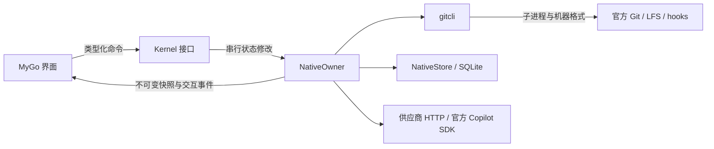

# Gitowl 模块与修改边界

当前生产路径是 MyGo 原生界面、同进程 Go 后台和随包官方 Git。以下边界用于定位代码、分配独立任务和选择验证范围；不改变产品功能。

## 运行关系



界面负责显示与输入；后台独占业务状态；Git 的仓库语义由官方程序执行。入口依据为 `app/native/main.go`、`internal/backend/kernel.go`、`native_commands.go` 和 `internal/gitcli/engine.go`。图为源码关系说明，未单独做图像渲染验收。

## 目录职责

| 位置 | 职责 | 修改时需要一起核对 |
| --- | --- | --- |
| `app/native/` | 原生窗口、控件、快捷键、工作台、本地编辑 | 后台快照、当前语言、现有控件测试 |
| `app/native/internal/backend/` | 业务命令、状态、账户、存储与平台交互 | 对应业务测试和调用方 |
| `app/native/internal/gitcli/` | Git 进程、机器输出、对象缓存、部分行与提交恢复 | 真实 Git、暂存保护、LFS/hooks 回归 |
| `app/native/internal/arcmd/` | 已登记来源的 Markdown 编辑能力 | `third_party/arcmd.json`、局部测试；不混入 Git 工作流 |
| `app/native/locales/` | 三种语言与生成的消息接口 | 修改 JSON 后运行生成入口，勿手改生成文件 |
| `tools/`、`script/` | 本地准备、检查、生成与打包 | 运行资源清单、来源摘要、仓库测试 |
| `third_party/` | 固定版本、来源、校验值、补丁和许可证 | 准备工具与生产资源 |
| `app/src/`、`app/test/` | 上游实现对照、旧协议/数据兼容、构建工具输入 | 单独的 Node 开发测试；不恢复生产 Node |
| `references/` | 长期契约、脱敏夹具、架构和验证说明 | 与实际生产入口保持一致 |

旧 TypeScript 的 AppStore、Dispatcher 和兼容服务仍在库中，但不是生产后台。`backend/client.go`、`process.go` 和旧协议适配用于开发兼容路径。不要为旧文件的行数机械重写或把它们当成当前性能热点。旧数据导出脚本仍是迁移输入，不能连同旧服务随意删除。

## 后台内部分工

| 文件 | 所有权 |
| --- | --- |
| `native_owner.go` | 初始化、生命周期、快照发布、共享状态定义 |
| `native_commands.go` | 命令解码、选中仓库检查、串行执行、取消通道 |
| `native_commit.go` | 所选改动提交、草稿结算和提交后推送 |
| `native_repository.go` | 仓库选择、状态刷新、包含项和草稿 |
| `native_refresh.go` | 文件监听、合批、退避和周期校准 |
| `native_history.go` | 历史分页、连续选择和比较端点 |
| `native_diff.go`、`native_diff_actions.go` | 差异预览、行选择、展开和丢弃 |
| `native_providers.go`、`native_provider_http.go` | 供应商设置/持久化与网络协议分别维护 |
| `native_accounts.go`、`native_oauth.go`、`native_git_credentials.go` | 账户、授权和 Git 凭据边界 |
| `native_store.go`、`native_legacy.go`、`native_migration_links.go` | 新存储与保留原文的旧数据迁移 |
| `native_media.go`、`native_apng.go` | 当前图片预览、解码和资源上限 |

`gitcli/engine.go` 负责进程与仓库句柄，`cache.go` 负责全局预算/同键请求合并，`object.go` 负责对象解析，`read.go` 统一差异参数，`partial.go` 和 `recovery.go` 负责写入保护。Git 层保持仅依赖标准库，不引入界面、账户或存储。

## 必须保留的契约

- `NativeOwner.mu` 保护业务状态。普通命令和后台刷新在这个边界内修改；已发布快照只读。不要让业务模块另建第二套选中仓库状态。
- 弹窗回复、平台回复和取消不能等待业务锁，否则会阻塞正在等待该回复的操作。关闭后台须取消正在等待的 I/O；已开始的不可中断 Git 写入仍按既有恢复规则结算。
- Git 状态读取成功不等于整个刷新成功。差异或元数据失败后不能消费新状态指纹，后续相同状态必须可重试。
- 冲突按钮由工作目录/暂存状态更新，不能仅跟随 refs/config 元数据更新。
- 文件列表、普通差异、未跟踪文件和部分行操作使用一致的重命名与路径前缀规则。不能让用户的显示配置改变可应用 patch 的语法。
- 预览文本、行选择与图片数据共同释放。离开预览不能继续保留无主图片缓存。
- 模型请求共用后台拥有的 HTTP 客户端，取消/超时沿调用链传递。模型只产生草稿；不得静默更换供应商或执行 Git 操作。

## 并行开发与验证

先按上表划分文件所有权，明确输入、输出和需要保留的行为。公共协议、状态字段、锁、依赖登记及构建入口由一名集成负责人协调，其他任务通过既有接口工作。每个任务使用独立临时目录和测试资料，不共用可变仓库夹具。

通过统一入口选择一个或多个模块：

```text
npm run test:kernel -- --package ./internal/gitcli
npm run test:kernel -- --package ./internal/backend --run TestNativeRefresh
npm run test:kernel -- --package ./internal/backend --package ./internal/gitcli
npm run test:kernel -- --package ./internal/backend --run Benchmark --bench BenchmarkNativeIdleRefresh
```

多个包在一次 Go 测试调用中执行。不要让多名 Agent 同时改写共享运行资源、暂存区、固定安装器或验证回执。共享工作区仍有其他任务编辑时，局部结果只作局部证据；源码冻结后统一运行完整验证和打包。

局部测试和基准不会写入完整构建回执。最终运行 `npm run test:kernel`、`npm run test:repo`、`npm run check:repo` 和受影响的生成/登记检查。回执绑定原生源码、资源、MyGo 补丁和运行文件，忽略临时试验和无关文档。依赖方向通过 `TestNativeArchitectureDependencyBoundaries` 检查。

## 后续演进顺序

1. 在当前模块内先补实际失败的行为测试，再修改拥有该行为的控制点。
2. 跨模块反复协调的行为先明确所有权；只有出现实际独立状态/复用需求时再提取包。
3. 继续测量大仓库的状态扫描、快照克隆与界面排队，再决定下一步性能改动。单次微基准不能代表启动、网络同步或总内存收益。
4. 旧 TypeScript 的进一步归档先核对迁移脚本、构建元数据、兼容夹具和许可证的真实使用关系。
